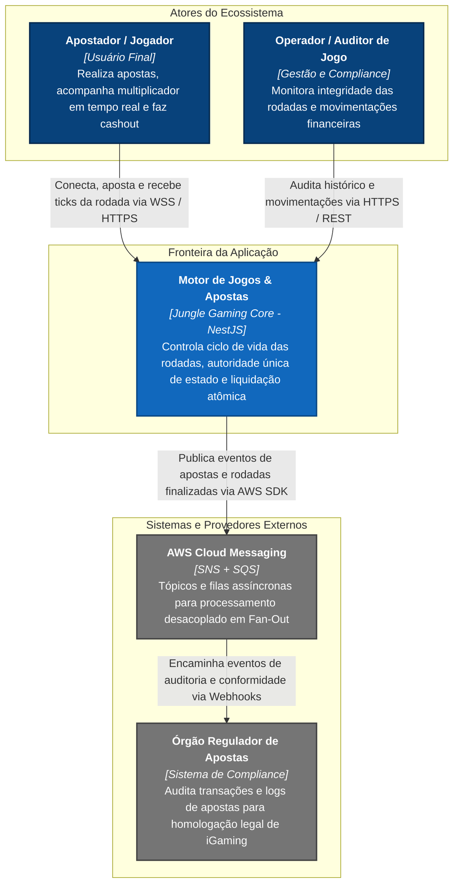
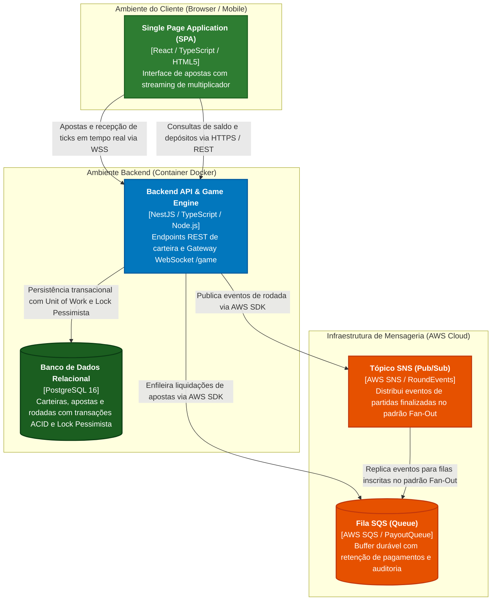
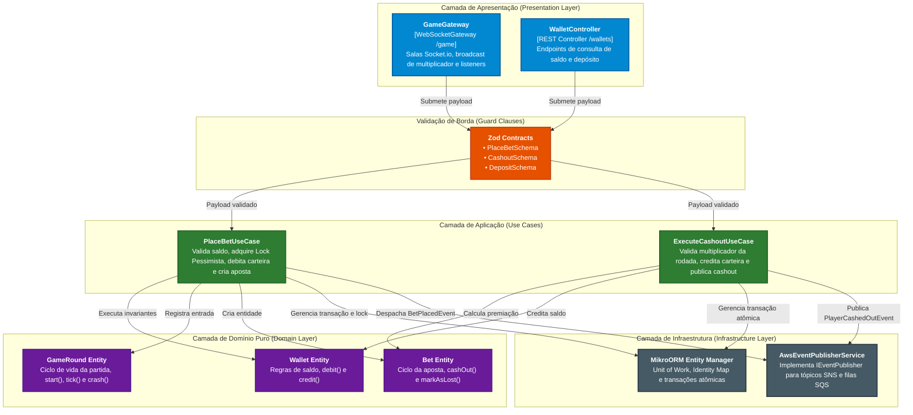
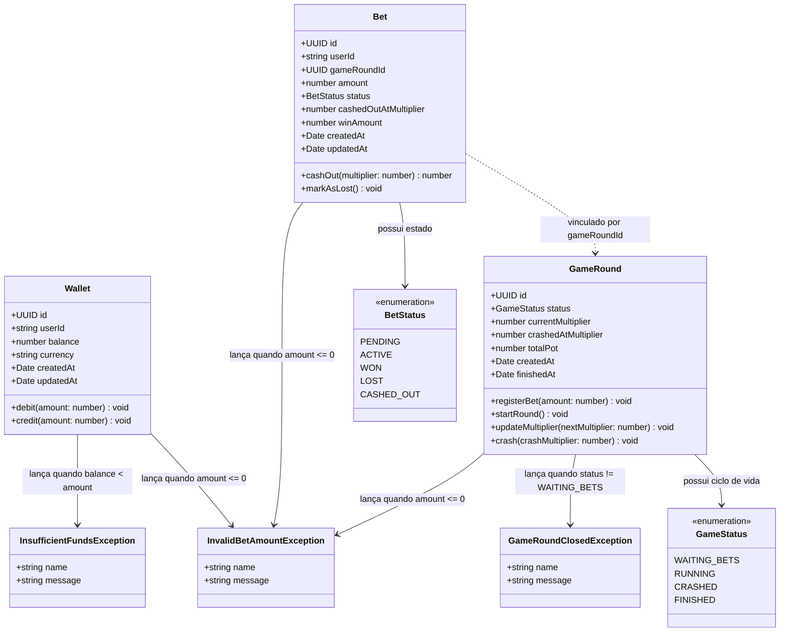

# Aprendendo Stack Jungle Gaming 🎮⚡

> Prova de Conceito (POC) arquitetural de um motor de apostas em tempo real (*Crash Game*) desenvolvido com **NestJS**, **WebSockets**, **MikroORM**, **PostgreSQL**, **Domain-Driven Design (DDD)** e arquitetura orientada a eventos com **AWS SQS & SNS**, documentado integralmente com o **Modelo C4**.

---

## 🎯 Contexto de Negócio

No ecossistema de **iGaming**, dois requisitos não-funcionais são inegociáveis:
1. **Baixa Latência & Comunicação Bidirecional:** O multiplicador do jogo é transmitido em frações de segundo para milhares de clientes conectados. O protocolo HTTP tradicional (com polling contínuo) geraria sobrecarga inaceitável. A comunicação é operada via **WebSockets (Gateways)** organizados em salas (*Rooms*).
2. **Consistência Estrita & Integridade Transacional (Zero Double-Spending):** Apostas e alterações de saldo jamais podem sofrer com condições de corrida (*race conditions*). A operação é executada atomicamente no **PostgreSQL** com isolamento transacional e bloqueio pessimista (**ACID** via `SELECT ... FOR UPDATE`).

---

## 🏛️ Arquitetura de Software — Modelo C4

O sistema foi modelado seguindo os 4 níveis do **Modelo C4** para fornecer rastreabilidade arquitetural completa da plataforma de jogos.

---

### Nível 1: Diagrama de Contexto do Sistema (System Context)

Mostra como o sistema de jogos se posiciona em relação aos seus usuários diretos e aos sistemas externos da organização.



---

### Nível 2: Diagrama de Contêineres (Containers)

Apresenta as aplicações, bancos de dados e serviços em nuvem implantáveis que compõem a solução.



#### Matriz de Tecnologias e Protocolos

| Contêiner | Tecnologia | Papel e Responsabilidade | Protocolo de Integração |
|---|---|---|---|
| **Frontend Web (SPA)** | React, TypeScript, HTML5 | Interface de usuário para exibição em tempo real do gráfico e controles de aposta. | WSS (WebSocket) / HTTPS (REST) |
| **Backend API & Engine** | NestJS, TypeScript, Node.js | Autoridade absoluta da partida, ciclo de vida das rodadas, controle de transações e eventos. | Execução em container Docker / Node.js 22 |
| **Banco de Dados** | PostgreSQL 16 | Persistência relacional com conformidade ACID, isolamento e bloqueio pessimista (`SELECT ... FOR UPDATE`). | Conexão TCP / Driver `pg` com pool |
| **Tópico de Eventos** | AWS SNS (`RoundEventsTopic`) | Distribuição de eventos de jogo em larga escala para múltiplos ouvintes (Fan-Out). | AWS SDK via TLS/HTTPS |
| **Fila de Mensagens** | AWS SQS (`PayoutQueue`) | Amortecedor de carga e retenção durável para auditoria e liquidações secundárias de saldo. | AWS SDK via TLS/HTTPS |

---

### Nível 3: Diagrama de Componentes (Components — Backend NestJS)

Detalha a estrutura modular interna da aplicação NestJS, evidenciando as camadas de **Apresentação**, **Aplicação**, **Domínio** e **Infraestrutura**.



---

### Nível 4: Diagrama de Código (Code — Modelo de Domínio e Classes)

Apresenta as entidades ricas do domínio, métodos de negócio encapsulados, tipos e invariantes que garantem a segurança do sistema sem dependências acopladas.



---

## 🔬 Decisões de Engenharia & Tecnologias

### 1. WebSockets & Rooms no NestJS
- O backend atua como a **autoridade única da verdade** (*Single Source of Truth*). O cliente apenas renderiza o estado recebido.
- Uso de **Rooms** (`server.to(gameRoundId).emit(...)`) para isolar o tráfego de cada partida ativa, eliminando broadcasting global desnecessário e otimizando a latência de rede.

### 2. MikroORM vs Prisma / TypeORM
- **Data Mapper & Entidades Ricas:** Diferente de tipos anêmicos, as entidades (`Wallet`, `Bet`, `GameRound`) encapsulam regras e invariantes de negócio, alinhando-se com os princípios do DDD.
- **Unit of Work & Identity Map:** Acumula alterações em memória durante o ciclo da requisição, detecta mudanças por *Dirty Checking* e dispara operações em **lote (batch)** no PostgreSQL via `em.transactional()`, reduzindo o tempo de bloqueio de conexões.
- **Proteção contra Gasto Duplo:** Uso de `LockMode.PESSIMISTIC_WRITE` (`SELECT ... FOR UPDATE`) na carteira durante a validação da aposta.

### 3. Padrão Fan-Out com AWS SNS + SQS
- **Desacoplamento Temporal & Amortecimento de Carga:** Quando o jogador aposta ou realiza cashout, tarefas secundárias (auditoria, métricas de leaderboard e liquidações de saldo) são despachadas assincronamente via **SQS** e **SNS**.
- Se um serviço consumidor sofrer lentidão ou indisponibilidade, a fila SQS retém as mensagens sem travar o motor da partida em tempo real.

---

## 📁 Estrutura do Projeto

```
src/
├── domain/                    # Regras de negócio puras (sem dependências de framework)
│   ├── entities/              # Wallet, Bet, GameRound
│   ├── enums/                 # BetStatus, GameStatus, TransactionType
│   └── exceptions/            # InsufficientFunds, InvalidBetAmount, GameRoundClosed
├── application/               # Casos de uso da aplicação
│   └── use-cases/             # PlaceBetUseCase, ExecuteCashoutUseCase
├── infrastructure/            # Implementações externas, banco e mensageria
│   ├── database/              # Configuração do MikroORM para PostgreSQL
│   └── messaging/             # AwsEventPublisherService (SNS + SQS)
└── presentation/              # Portas de entrada (WebSockets e REST)
    ├── contracts/             # Schemas e validação de borda com Zod
    ├── controllers/           # WalletController
    └── gateways/              # GameGateway (Socket.io)
tests/                         # Suíte de testes automatizados com cobertura rigorosa
```

---

## 🚀 Como Executar

### Pré-requisitos
- **Node.js** >= 20.x
- **Docker** & **Docker Compose**

### 1. Clonar e Instalar Dependências
```bash
git clone <url-do-repositorio>
cd aprendendo-stack-jungle-gaming
npm install
```

### 2. Iniciar o Banco de Dados com Docker
```bash
npm run docker:up
```

### 3. Executar a Suíte de Testes com Cobertura
```bash
npm run test
```
*Cobertura esperada: 100% de statements, branches e linhas em domínio, aplicação e apresentação.*

### 4. Executar em Modo de Desenvolvimento
```bash
npm run start:dev
```
- API REST: `http://localhost:3000`
- WebSocket Gateway: `ws://localhost:3000/game`

---

## 🧪 Cobertura de Testes Automatizados

Suíte construída com **Vitest** seguindo separação estrita de camadas e sem mocks espúrios no domínio:
- Testes unitários com validação de limites numéricos e cenários de borda.
- Testes de concorrência com simulação de bloqueio pessimista e controle transacional.
- Testes de validação de schemas Zod atuando como *Guard Clauses* na borda do sistema.
